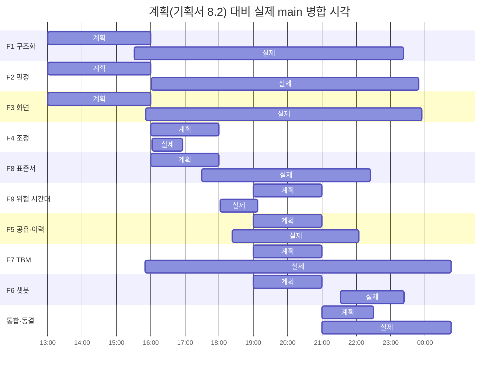

# 🍲 한솥밥 결과보고서

> 팀 세이프루프(SafeLoop) · 프로젝트 한솥밥 · 트랙 제철소 안전·효율
> POSCO K-뉴딜 아카데미 해커톤 「FORGE THE AI FUTURE」 (2026-11-09 ~ 11-10)
> 기준 문서: `docs/40_기획서_최종.md` · 소스: github.com/posco-hackathon/hansotbap (main `9dfdab5`)
> 진척·협업 수치는 GitHub PR 기록(병합 66건·닫힘 2건)과 커밋 기록에서 셌다. 시각은 모두 한국 시간이다.

**이 보고서의 모든 데이터와 화면은 합성 데이터이며 협력사명은 가상(`가상-…`)이다.** 기준 현장(포스코 광양 2고로 개수, 2026-11-12 ~ 2027-03-23)은 언론에 공개된 공사 기간을 공정 일정의 시기 근거로만 썼고, 실제 사내 자료·시스템 정보는 쓰지 않았다. 왜 이렇게 했는지는 5장에 적었다.

## 목차

1. 요약
2. 기획서 대비 진척 — 성공 기준 · 기능별 상태 · 시간대별 진척 · 공식 일정 · 바꾼 것 · 못한 것 · 더 한 것
3. 팀 역할과 협업
4. 만든 것
5. 데이터·문서를 만든 기준과 이유 (대외비 대체 문서, 시간·인원·비용 기준, 팀 설정값)
6. 측정 결과
7. 시연
8. 기대 효과와 확장

---

## 1. 요약

고로 개수처럼 협력사 10여 곳이 한 현장에 동시에 들어오는 공사에서, 계획서는 하나씩 보면 정상이지만 겹쳐 놓으면 위험하다. 한솥밥은 양식이 제각각인 협력사 작업계획서를 AI로 구조화하고, 그 위에 규칙으로 계획 간 충돌을 찾아 원청이 착수 전에 조정하게 한다.

| 질문 | 답 |
|---|---|
| 기획서대로 했나 | 필수·연결 기능 9개(F1~F9)를 모두 실제 동작까지 구현했다. 선택 기능(동선 시뮬레이션)만 계획대로 뺐다. 범위를 줄이는 기준(16:00·19:00)은 한 번도 발동하지 않았다 (2.2) |
| 일정은 지켰나 | 공식 일정(기획서 제출 13:30, 결과물 마감 11/10 02:00)은 지켰다. 팀 안의 목표 중 「16:00 1차 연결」은 약 30분, 「22:30 기능 동결」은 약 2시간 넘겼다. 넘긴 시간에는 새 기능 대신 판정 오탐을 고쳤다 (2.3·2.4) |
| 무엇을 바꿨나 | 판정 단위를 「기간」에서 「날짜 × 하루 작업시간대」로, 간트를 라이브러리에서 자체 구현으로, 표준서 매칭을 임베딩 위주에서 규칙 위주로 바꿨다. 이유는 모두 시연 데이터로 시험하다 드러난 문제다 (2.5) |
| 무엇을 못했나 | 규칙 R26~R29, 사람과의 속도 비교, 임베딩 측정, 3D용 방위·장비·계통 칸, LLM 비교 측정의 재현 스크립트 (2.6) |
| 무엇을 더 했나 | 원청 승인 단계, 출입 제한 3D 표시, AI·규칙 비교 실험, 작업표준서 41종, 계획서 22건(4개 양식) 등 (2.7) |
| 핵심 수치 | 계획서 추출 99.7%(규칙만, 360칸), 기준 일정 충돌 0건 + 시연 장면 7개 전부 검출(pytest 268건), 양식이 제각각이면 혼합(auto) 99.0% vs 규칙만 71.4% (6장) |

AI와 규칙이 무엇을 맡는지도 수치로 확인했다. 표준서를 고르는 일은 LLM이 규칙보다 나았고(80.0% → 96.7%), 표준서의 필수 단계가 계획서에 적혀 있는지 판정하는 일은 규칙이 나았다(잘못 검출 0건 대 7건). 「판정은 규칙, LLM은 추출·설명」이라는 설계와 같은 결과다.

---

## 2. 기획서 대비 진척

### 2.1 성공 기준 (기획서 0.3)

| 기준 | 결과 | 근거 |
|---|---|---|
| 합성 계획서에서 업체·작업·기간·위치·작업 유형 추출 (정답셋 대비 정확도 측정) | **달성** | 시연 표본 99.7%, 통일 양식 99.1%, 양식 변형 72.0% (6.1) |
| 충돌 4유형(같은 시간·구역 / 위아래 / 화기×가스 / 순서 위반) 판정 | **달성** | 규칙 30개 중 26개 구현, 4유형 + 표준서 결함 (6.3) |
| 계획서 변경 → 재판정 → 새 충돌 알림까지 한 번에 동작 | **달성** | 조정안 적용 시 즉시 재판정, 사라진·새로 생긴 충돌을 비교한 뒤 화면을 한 번 강제 새로고침 |
| 원청 화면과 협력사 화면이 권한에 따라 다르게 보임 | **달성** | 서버에서 거른다. 협력사는 상대 업체의 원문 문장·투입 인원을 받지 않는다 |

### 2.2 기능별 상태 — 계획과 결과

| 기능 | 기획서 우선순위 | 결과 | 기획서와 다른 점 |
|---|---|---|---|
| F1 계획서 구조화 | 필수 | **완료** — PDF·엑셀·HWPX·Word 4종 파서, 추출 3모드(rules/llm/auto), 원문 근거(쪽·줄 표식), 사람이 확인·수정 후 제출 | Word 추가. LLM 전용이 아니라 「표 규칙 먼저, 못 읽으면 LLM」 |
| F2 충돌 판정 | 필수 | **완료** — 규칙 26개(R01~R25·R30), 금지·조건부·결함 3단계, 위험 분류는 시행령 제53조의2 1~8호 | 판정 단위를 「날짜 × 하루 작업시간대」로. R26~R29 제외 |
| F3 시각화 | 필수 | **완료** — 시간표형 간트(자체 CSS Grid)가 메인, 고로 3D는 층 전체 보기 ↔ 층 선택 시 2D 도면, 하루 작업시간대 반영 | vis-timeline → 자체 구현. 출입 제한(안전띠·러버콘) 표시 추가 |
| F4 조정안·재대조 | 필수 | **완료** — 일정 이동 조정안 + 이유 문장(LLM 다듬기 선택), 적용 시 즉시 재판정·되돌리기 | 되돌리기 추가 |
| F5 공유·이력 | 필수 | **완료** — 권한별 공유, 결정 책임자 기록(비면 422), 제64조 이행 기록 엑셀 내보내기 | **원청 승인·반려 단계 추가** |
| F8 작업표준서 매칭 | 필수 | **완료** — 표준서 41종, 매칭 이유·점수, 주 표준서 핵심 단계 누락은 F2 결함으로 | 임베딩 위주 → 규칙 위주(임베딩은 설정 시 보강만) |
| F9 위험 시간대 예보 | 필수 | **완료** — 판정 결과를 구역·시간대로 집계해 점수·근거·공지 문장 | — |
| F6 챗봇 | 연결 | **완료** — 조회 함수(도구) 기반, SQL 실행 없음, 모델 4종 선택, LLM이 늦거나 실패하면 규칙으로 답 | 기획서는 「부족하면 목업」이었으나 실제 동작 |
| F7 TBM 전달 확인 | 연결 | **완료** — Whisper 받아쓰기 → 전달 항목별 언급 여부 판정, 빠진 항목 알림 | 기획서는 「부족하면 단일 녹음 데모」였으나 화면·이행 기록까지 |
| 동선 시뮬레이션 | 선택(여유 시) | **미착수** | 계획대로 뺐다 |

### 2.3 시간대별 진척 — 계획 대비 실제

**main에 병합된 PR 누적 (한 칸 = 2건)**

```
11/9 14시 |                                    1
     15시 |███                                 6
     16시 |█████████                          18   ← F1·F2·F3 뼈대·F4 엔진이 main에 모임
     17시 |██████████                         20
     18시 |████████████▌                      25   ← F5·F9·업로드→3D 흐름 연결
     19시 |██████████████████▌                37   ← F7 TBM·작업별 표준서 37종
     20시 |███████████████████▌               39
     21시 |██████████████████████████         52   ← React 이식·비교 실험·F6 챗봇
     22시 |████████████████████████████▌      57   ← 원청 승인·표준서 41종
     23시 |████████████████████████████████▌  65   ← 판정 단위 변경·기준 일정 충돌 0건
11/10 00시|█████████████████████████████████  66
```

**기능별로 main에 처음 들어온 시각과 마지막으로 고친 시각 (계획 칸은 기획서 8.2)**



**마일스톤별 판정**

| 계획 | 목표 | 실제 | 판정 |
|---|---|---|---|
| 13:20 | 기획서 제출 | 저장소 시작 13:33, 개발환경 고정 PR 14:33 병합 | 공식 13:30 제출 기준 정상 |
| 16:00 | F1→F2→F3 1차 연결 | F1 15:31, 3D 15:56, F4 엔진 16:03, F2 전체 규칙 16:26 main 병합 | **약 30분 늦음.** 화면에서 업로드→판정→3D가 실제로 이어진 것은 18:28(#35) |
| 16:00–18:00 | F4 조정·재판정, F8 표준서 | F4 API 16:56, F8 17:30 | 계획 안 |
| 19:00–21:00 | F9·F5·F6·F7 | F9 18:02, F5 18:26, F7 19:08, F6 21:32(서버)·22:04(화면) | F9·F5·F7은 **앞당김**, F6은 약 30분~1시간 늦음 |
| 21:00–22:30 | 통합 시험·정확도 측정 → 22:30 기능 동결 | 비교 실험 1차 21:01. 통합 시험에서 오탐 발견 → 22:58 판정 단위 변경, 23:49 기준 일정 재구성 | **동결 약 2시간 넘김** (아래) |
| 24:00 | 결과물 4종 제출(팀 목표) | 마지막 main 병합 00:46(#80) | 팀 목표는 넘겼고 공식 마감 02:00 안 |

**범위 조정 기준은 발동하지 않았다.** 기획서는 「16:00까지 F1→F3 연결이 안 되면 F8·F9 단순화, 19:00까지 F4가 안 되면 F6·F7은 목업」으로 정했다. 16:26에 F1·F2·F3 부품이 main에 모였고 F4는 16:56에 API까지 들어와, 두 기준 모두 걸리지 않았다.

**22:30 동결을 넘긴 이유.** 통합 시험에서 기준 일정만 깔아도 충돌이 수십 건 나왔다. 기간(며칠~몇 주)만 보고 판정해서, 같은 날 오전·오후로 나눠 일하는 업체끼리도 겹친다고 본 것이다. 이대로면 원청 일정 자체가 빨갛게 보여 「계획이 바뀐 순간 충돌이 생긴다」는 핵심 장면이 흐려진다. 그래서 새 기능은 넣지 않고 ① 판정 단위를 「날짜 × 하루 작업시간대」로 바꾸고(22:58, #74) ② 기준 일정을 업체가 오전·오후로 이어받게 재구성하고 시연 계획서를 안 겹침 15건·겹침 7건으로 다시 나눴다(23:49, #78). 이후 병합(23:55 3D 시간대 반영, 00:46 TBM 마이크 안내)도 같은 수정에 맞춘 화면 쪽 정리다.

### 2.4 공식 일정 준수

| 공식 일정 | 시각 | 상태 |
|---|---|---|
| 팀별 회의·기획 | 11/9 09:30 | 진행 (기획서 0~11장 확정) |
| 집중 개발 시작 | 11/9 13:10 | 진행 (13:33 저장소 시작) |
| 기획서 제출 | 11/9 13:30 | 제출 |
| 결과물 제출: 소스코드 / 최종 결과보고서 / 발표자료 / 시연 영상 | 11/9 18:00 ~ 11/10 02:00 | 소스코드(main) · 결과보고서(이 문서) · 시연 영상 준비. 발표자료 〔제출 여부 기입〕 |
| 최종 발표 및 심사 | 11/10 14:00 | 리허설 11/10 09:00–13:30 (기획서 8.2) |

### 2.5 기획서에서 바꾼 것과 이유

| # | 기획서 | 바꾼 결과 | 이유 |
|---|---|---|---|
| 1 | 충돌은 작업 「기간」이 겹치면 판정 | **「날짜 × 하루 작업시간대」**로 판정. 같은 날 같은 구역이라도 오전·오후로 나뉘면 겹치지 않고, 끝과 시작이 맞닿는 인계는 겹침이 아님 | 기간만 보면 기준 일정만으로 노 내부 위아래 겹침이 39쌍 나왔다(문서 20 §4). 실제 현장은 하루를 나눠 이어받으므로, 기간 판정은 오탐이다 |
| 2 | 기준 일정은 작업 분해표 날짜 그대로 | 작업마다 **하루 작업시간(오전 07~12 · 오후 13~18 · 하루 07~18)**을 두고 업체가 서로 이어받게 재구성 → **기준 일정 충돌 0건** | 원청이 짠 일정은 정상이어야 한다. 그래야 협력사가 계획을 바꿔 낸 순간에만 빨간색이 생기고, 그 차이가 시스템의 가치다 |
| 3 | 24시간 2교대(시안) | **주간 작업만** | 기준 일정이 주간 작업만이라 야간조 판정이 오탐만 만들었다. 2교대 화면(#37)은 만들었다가 뺐다(#74·#75) |
| 4 | 간트는 vis-timeline | **자체 구현(CSS Grid)** | 구역별 줄·겹침 띠·조치 카드 연결이 라이브러리 제약에 걸렸다. 쓰지 않는 의존성은 지웠다 |
| 5 | F8은 LM Studio 임베딩 + FAISS가 중심 | **규칙 매칭이 중심**, 임베딩은 설정했을 때 순위·이유 보강만(결함 판정에는 안 씀) | ① 결함은 F2 판정으로 넘어가므로 「판정은 규칙」 원칙을 따른다 ② 표준서 수십 개 규모는 적용 목록·작업명 낱말로 충분하다 ③ 같은 입력이면 같은 결과가 나와야 한다. 비교 실험에서도 누락 판정은 규칙이 나았다(6.4) |
| 6 | F1은 파서 + Claude | **표 규칙 먼저, 못 읽은 것만 LLM(auto)** 을 기본값 | 아는 양식은 규칙만으로 99% 이상 읽혔고 비용·지연이 0이며 시연 중 API 장애에도 동작한다. 양식이 제각각일 때만 LLM이 필요했다(6.2) |
| 7 | 로컬 LLM은 LM Studio | **Unsloth Studio + LM Studio 둘 다**, 같은 LLMProvider 뒤 | 팀원 PC마다 깔린 도구가 달랐다. 설정만 바꿔 같은 코드로 돌게 했다 |
| 8 | 권한은 「원청 / 협력사 A~E」 역할 선택 | **가상 협력사 15곳** 중 선택 | 기준 일정 37작업을 맡을 업체가 15곳 필요했다. 업체마다 계획서·표준서 묶음을 만들었다 |
| 9 | 합성 계획서 5종(HWPX·엑셀·PDF) | **시연 22건(4개 양식) + 정확도 시험 25건** | 협력사 15곳 모두 낼 문서가 필요했고, 시연 장면 7개마다 겹치는 파일이 따로 필요했으며, 정확도를 말하려면 칸 400개 이상의 표본이 필요했다 (5.3) |
| 10 | 작업표준서 「샘플」 | **공통 4종 + 작업별 37종 = 41종**, 사람이 보는 PDF 포함 | 작업마다 주 표준서가 하나 있어야 「핵심 단계 누락 → 결함」을 작업 단위로 정확히 낼 수 있다 |
| 11 | 3D는 react-three-fiber로 화면 안에 | three.js 장면(`scene3d`)을 별도 모듈로 만든 뒤 Vite 빌드로 합침 | 3D 담당이 화면 시안과 따로 먼저 만들고(처음엔 iframe), 서버 판정과 연결하면서 빌드에 넣었다 |

### 2.6 하지 못한 것과 이유

| 못한 것 | 이유 | 영향 / 다음 |
|---|---|---|
| 동선 시뮬레이션 | 기획서에서 「선택(여유 시)」. 필수·연결 9개를 실제 동작까지 만드는 데 시간을 썼다 | 확장 계획(8.2) |
| 규칙 R26~R29 (단일 허가서 결함·허가 상호참조) | 작업허가서 정보가 있어야 판정할 수 있는데, 전자 작업허가 구축은 범위 밖이다. 엔진에서 뺐다고 코드에 적었다 | 작업허가 시스템과 연동하면 켤 수 있다 |
| 사람과의 속도 비교 (팀원 2명이 계획서 5건을 손으로 대조) | 시간이 없었다. 추정치를 쓰지 않기로 해서 수치를 비워 둔다 | 「재대조 시간 단축」은 아직 수치로 말하지 못한다 |
| 임베딩 방식 측정 (F8) | 설정에 임베딩 모델 이름이 없어 띄울 서버가 없었다 | 규칙·LLM 비교만 있다 |
| 3D용 방위·장비·계통 칸 | 규격(`docs/51`)은 정했으나 데이터 계약(`schemas.py` ↔ `types.ts`)에 넣지 못했다. 지금 3D는 계통을 작업명으로 추정한다 | 규격대로 칸을 넣으면 3D가 구역 안 방위·장비까지 그린다 |
| LLM 비교 측정의 재현 스크립트 | 각자 PC에서 돌렸고 저장소에 넣지 못했다. 결과 수치만 남았다 | 규칙 경로 측정은 저장소 스크립트로 다시 돌릴 수 있다 |
| TBM 항목 판정을 실제 LLM 경로로 측정 | 측정 시점에 API 키가 없어 키워드 대조로 대신했다 | 6.5에 명시 |
| 이슈와 PR 연결 | 기능별 이슈 12개를 만들었으나 PR과 연결·종료하지 못했다 | 진행 관리는 PR 제목의 기능 번호로 대신했다 |

### 2.7 기획보다 더 한 것과 이유

| 더 한 것 | 이유 |
|---|---|
| **원청 승인·반려 단계** (#68): 제출 계획서는 승인 대기, 금지 판정이나 출입 제한 구역 안 작업이 남으면 서버가 승인을 막음(422), 승인된 작업만 3D에 확정 | 「결정은 사람이 한다」를 화면으로 보이게 했다. 판정만 보여 주고 끝나면 원청이 무엇을 결정했는지 기록이 남지 않는다 |
| **출입 제한 3D 표시**: 방위별 안전띠·러버콘·출입 금지 표지, 2D 도면의 시간대별 금지 방위·금지 이유·일어날 수 있는 사고, 구역 안 작업 긴급 알림 | 표준서의 「작업 금지·출입 제한」 절을 현장 작업자 눈높이로 보여 주기 위해서다. 충돌 목록만으로는 「어디로 가면 안 되는지」가 안 보인다 |
| **AI·규칙 비교 실험** (#55, 6.2·6.4) | 기획서는 추출 정확도 측정만 있었다. 「AI가 꼭 필요한가, 어디까지 맡겨야 하나」를 수치로 답하려고 조건 5개(LLM만 / 파싱+LLM / 규칙 / auto / 통일 양식)를 같은 표본으로 비교했다 |
| **계획서 Word(.docx) 파서** | 협력사가 실제로 쓰는 양식에 Word가 많다. 양식을 강제하지 않는다는 원칙상 받아야 한다 |
| **세부 작업 대체**: 계획서에 같은 기준 작업 행이 여럿이면 세부 ID(P13-1~3)를 붙이고 기준 한 덩어리 대신 그 행들로 판정 | 협력사는 기준 작업을 쪼개 낸다(발파 전후, 구역별). 쪼갠 것을 그대로 판정하지 않으면 자기 기준 작업과 겹친다고 나온다 |
| **기준 일정 끄기(USE_BASELINE=false)** | 기준 일정이 없는 원청도 올린 계획서만으로 쓸 수 있게 했다. 「시스템이 없는 원청은 계획서를 올린다」는 기획서 4.3의 경우다 |
| **챗봇 모델 4종 선택, 규칙 대체 답** | 시연 중 LLM이 늦거나 끊겨도 답이 나와야 한다. 45초 안에 LLM이 답하지 못하면 조회 결과로 규칙 답을 낸다 |
| **지난 6일치 현장 기록 30건** (이력 화면) | 이력 화면이 비어 있으면 「제64조 이행 기록」이 어떻게 쌓이는지 보여 줄 수 없다. 판정·조정 표에는 넣지 않아 판정에 영향이 없다 |
| **협력사별 문서 폴더** (`docs/협력사별_문서/`) | 협력사 한 곳이 실제로 받는 묶음(내 계획서 + 내 작업에 걸린 표준서)을 심사위원이 바로 열어 볼 수 있게 했다 |

---

## 3. 팀 역할과 협업

### 3.1 계획한 역할과 실제로 한 일

PR 작성자 기준으로 셌다(병합 66건). 아카데미 공용 PC 등 다른 계정으로 만든 커밋도 해당 팀원의 PR로 main에 들어갔다.

| 팀원 (GitHub) | 기획서 역할 | 실제로 한 일 | PR |
|---|---|---|---|
| 김명재 (m-kim77) | 팀장·PM·발표, 데이터 | 기획서·결과보고서 / 합성 데이터 전부: 계획서 22건·정답셋, 작업표준서 41종·PDF, TBM 대본·합성 음성, 협력사별 문서 폴더 / F7 Whisper 연결, 로컬 LLM(Unsloth·LM Studio) 연결 / F3 업로드→표준서 매칭→제출→3D 흐름 연결, 실사용 화면 정리 / **F5 원청 승인** / **F2 판정 단위 변경·기준 일정 재구성(충돌 0건)** / 시연 시나리오 | 13 |
| 정건희 (donasman) | 백엔드·AI, 백엔드·규칙 | 모노레포·개발환경 고정 / **F1 추출 엔진**(파서·표 규칙·LLM 구조화·검증) / **F2 규칙 엔진 R01~R25·R30**, 판정 저장 / **F8 매칭·누락 판정** / DB·seed / 권한 범위 / 상황판·3D React·Vite 이식 / USE_BASELINE / README API / **PR 병합·리뷰 54건** | 25 |
| 이창민 (bfwkyc) | 백엔드·AI, 백엔드·규칙 | F2 순서 위반 R08 / **F4 조정안 엔진·적용·되돌리기·재제출 비교** / **F9 위험 시간대 집계·공지** / **F5 공유·이행 기록 엑셀** / 제출 응답 공유 범위 제한 / **F7 TBM 전달 판정 서버** | 9 (+닫힘 1) |
| 김동건 (dgkim0996-crypto) | 3D·프론트, 프론트 | **고로 3D(scene3d)**: 출입 제한 안전띠·러버콘, 긴급 알림, 위험 대시보드·말풍선, 2D 도면 금지 방위 / **시안 화면 React 이식**(상황판 시간표·조치 카드·업로드 창·이력·TBM·챗봇 배치) / 헤더 / **백엔드 비교 실험 측정 도구·변형 표본** | 12 |
| 이상혁 (salamance95) | 3D·프론트, 프론트 | **화면 시안 프로토타입**과 3D 연결 / **F6 챗봇** 서버(조회 함수·규칙 대체)·화면·모델 선택 / Whisper CPU 대기 시간 실측·설정 / 3D 화면 비율·야간조 제거 | 8 |

**계획 대비 달라진 점.** 기획서는 「백엔드 2명 / 프론트·3D 2명 / PM·데이터 1명」으로 층을 나눴지만, 실제로는 기능 하나를 한 사람이 서버부터 화면까지 끝까지 맡는 쪽으로 바뀌었다. F6 챗봇은 프론트 담당이 서버까지, F7 TBM은 서버(이창민)·음성 연결(김명재)·CPU 설정(이상혁)으로 나눴다. 비교 실험 측정 도구는 3D 담당이 만들었다. PM은 데이터 제작과 함께 판정 오탐 수정(2.3)을 직접 맡았다.

### 3.2 협업 방식

| 항목 | 기획서 9장 | 실제 |
|---|---|---|
| 브랜치 | `feat/F<번호>-<이름>` | 지켰다 (예: `feat/F2-relay-schedule`, `fix/F2-rule-keywords`) |
| 커밋 | `[F<번호>] 내용` | 지켰다. 마지막 몇 건(헤더·도면 등 화면)은 기능 번호가 빠졌다 |
| PR | 작은 단위, 다른 개발자 1명 확인 후 merge, 리뷰 30분 안 | PR 68건(병합 66 · 닫힘 2). 올린 뒤 병합까지 **중앙값 2.4분**, 30분 안 60건(91%), 가장 긴 것 92분. 정건희가 54건을 병합했다 |
| 데이터 계약 | `schemas.py` ↔ `types.ts` 같은 모양 | 백엔드가 계약을 바꾸면 `docs/frontend-requests/` 에 요청 파일(상태: 미반영 → 반영됨)을 올려 프론트가 반영했다. 요청 5건 모두 반영 |
| 비밀 정보 | `.env` 에만 | 지켰다. 키는 각자 `.env` 에 넣고 `.env.example` 만 공유 |
| `main` 은 항상 시연 가능 | | 병합 뒤 깨진 경우는 바로 다음 PR로 고쳤다 (예: #59 병합 뒤 시험 23건이 깨짐 → 8분 뒤 #61로 수정, #65 3D 빌드 누락) |
| 범위 결정 | 결정사항 메모 | 「판정은 규칙」「합성 데이터 표시」「주간 작업만」 같은 결정은 저장소 `CLAUDE.md`·문서에 적어 모두가 같은 기준으로 작업했다 |

### 3.3 잘된 점과 아쉬운 점

**잘된 점**
- **계약 문서로 나눠 일했다.** 데이터 계약, 프론트 반영 요청 파일, 3D 연결 데이터 규격(`docs/51`) 덕분에 5명이 같은 파일을 동시에 고치지 않고도 연결됐다.
- **작은 PR을 자주 올렸다.** 한 시간에 많게는 13건이 병합됐고, 병합 충돌은 작성자가 main을 받아 풀고 올렸다.
- **시험이 먼저 잡았다.** 시연 장면 7개가 반드시 내야 하는 충돌을 pytest에 박아 두어, 22시 이후 판정 단위를 바꿀 때도 장면이 깨지지 않았는지 바로 확인했다.

**아쉬운 점**
- **리뷰가 형식에 가까웠다.** 중앙값 2.4분은 사실상 확인 없이 병합한 것이다. 「#20 누락분」(#26), 「#34 누락분」(#36)처럼 병합 과정에서 빠진 코드를 다시 올린 일이 두 번 있었다. PM 자신의 PR 11건은 본인이 병합했다.
- **22:30 동결을 못 지켰다.** 통합 시험을 21시에 시작해 오탐을 늦게 발견했다. 기준 일정 위에서 「충돌 0건」을 먼저 확인하는 시험이 오후에 있었다면 일찍 고칠 수 있었다.
- **이슈를 쓰지 않았다.** 기능별 이슈 12개가 열린 채로 남았다.

---

## 4. 만든 것

### 4.1 흐름

```
[협력사 계획서 업로드] → [F1 구조화·사람 확인] → [F8 표준서 매칭]
  → [제출 순간 F2 판정] → [원청 승인 대기] → [F3 간트·3D 표시]
  → [F4 원청 조정안 적용·즉시 재판정] → [원청 승인]
  → [F9 위험 시간대 공지] → [F5 협력사별 공유·이행 기록] → [F6 챗봇 조회] → [F7 TBM 전달 확인]
  ↺ 계획 변경은 말이 아니라 수정 계획서 재제출 → F1부터 다시
```

### 4.2 설계 판단 네 가지

1. **판정은 규칙, LLM은 추출·설명·문장만.** `rules/` 는 LLM을 호출하지 않고 pytest로 검증한다. 같은 계획서를 두 번 넣으면 같은 판정이 나온다.
2. **모든 판정에 근거 3종.** 규칙 ID(`rule_id`), 법 조문(`legal_basis`), 계획서 원문 문장(`sources`). F2는 산업안전보건법 제64조 제1항 7·8호(혼재작업 확인·조정), F8은 제65조(도급 시 안전·보건 정보 제공)에 걸린다.
3. **권한은 서버에서 거른다.** 협력사는 자기 작업과 원청이 공유한 충돌의 상대 작업만 받고, 상대 업체의 원문 문장·투입 인원은 응답에 담기지 않는다. 챗봇도 LLM 답에 조회 결과 밖의 작업·업체가 나오면 규칙 답으로 바꾼다.
4. **결정은 사람이 한다.** 시스템은 작업을 승인·중지하지 않는다. 조정안은 제안이고, 적용·되돌리기·승인·반려에는 책임자 이름이 반드시 들어간다.

### 4.3 구현 규모

| 항목 | 값 |
|---|---|
| 백엔드 | Python/FastAPI 8,239줄 (api 13 · rules 10 · db 10 · llm 9 · parsers 8 · chat 5 · search 4 · stt 2 파일) |
| 프론트 | React + TypeScript 7,195줄 (shadcn/ui 기본 컴포넌트 제외) + three.js 3D 장면 |
| API | 엔드포인트 33개 (GET 22 · POST 10 · DELETE 1) |
| 테스트 | pytest 268건 전부 통과 (62.4초) |
| 기준 데이터 | 작업 분해표 37작업(39행) · 구역 14 · 충돌 규칙 R01~R30 · 작업표준서 41종 |
| 합성 데이터 | 시연 계획서 22건(안 겹침 15 + 겹침 7) · 추출 시험용 25건(양식 변형 20 + 통일 양식 5) · TBM 합성 음성 1건 · 현장 기록 30건 |
| 협업 | PR 68건(병합 66), main 커밋 204개, 기간 11/9 13:33 ~ 11/10 00:46 |

---

## 5. 데이터·문서를 만든 기준과 이유

### 5.1 왜 실제 문서 대신 대체(합성) 문서를 만들었나

1. **실제 문서는 대외비다.** 협력사 작업계획서, 원청 작업표준서, 개수 공정표는 회사 내부 자료다. 해커톤 참가자는 받을 수 없고, 받더라도 공개 저장소·발표 자료에 올릴 수 없다.
2. **그래도 「실제처럼」이어야 했다.** 현장 전문가가 보면 바로 어긋나는 데이터로는 판정이 맞는지 보일 수 없다(기획서 11장 리스크). 그래서 **공개 출처만으로** 실제 공사의 구조를 다시 짰다 — 언론에 공개된 공사 기간, 다른 고로 개수의 공개 공정 비율, 해외 개수 사례, KOSHA GUIDE, 산업안전보건기준에 관한 규칙, 계획서 기재사항(시행규칙 별표4).
3. **실제로 오해받지 않게 했다.** 협력사명은 모두 `가상-…`, 화면·PDF 꼬리말에 「합성 데이터」, 사람은 직함만 쓴다. 실제 회사 내부 자료처럼 보이게 만들지 않는다(문서 20 머리말).
4. **정답을 알아야 잴 수 있다.** 실제 문서는 정답(무엇이 추출돼야 하고 어떤 충돌이 나야 하는지)이 없다. 합성 문서는 만들 때 정답셋을 같이 만들어 정확도를 숫자로 잴 수 있다.

### 5.2 모든 합성 데이터에 적용한 원칙

| 원칙 | 내용 |
|---|---|
| 출처가 있는 것과 가정을 나눈다 | 작업 단위·순서·위험은 출처 기반, 날짜·인원·금액은 가정값으로 열 이름이나 문서에 표시(`투입인원(가정)`, 「가상 금액」) |
| 원본은 하나, 나머지는 변환 | 계획서는 `make_samples.py`, 표준서는 마크다운 → PDF(`make_sop_pdf.py`), 협력사별 폴더는 복사 스크립트. 손으로 고친 사본이 원본과 어긋나지 않게 |
| 판정이 읽는 칸과 사람이 보는 칸을 나눈다 | 비용·결재란·비상연락 같은 칸은 실제 계획서처럼 넣되 판정·3D에는 쓰지 않는다 |
| 근거 수치가 없는 값은 `[팀 설정값]` | 코드 주석과 데이터에 표시해 출처 있는 수치와 섞이지 않게 (5.7) |
| 위험 분류는 법 그대로 | 산안법 시행령 제53조의2 1~8호(화재·폭발, 끼임, 충돌, 추락, 낙하·비래, 전도, 붕괴, 질식·중독) + 기타(방사선·수증기·고압수) |

### 5.3 데이터·문서별 기준과 이유

| 데이터 | 위치 | 무엇을 기준으로 만들었나 | 왜 이렇게 만들었나 |
|---|---|---|---|
| **기준 일정(작업 분해표) 37작업** | `app/backend/data/gy2bf_wbs.csv`, 문서 20 | 국내 고로 개수 공개 마일스톤 비율(종풍 → 해체 약 절반 / 축조·설치·복구 약 절반, 축조 시작 약 66일차)을 132일에 환산, 해외 개수 공정(기미쓰·Port Talbot·Linz 등)으로 작업 단위 보강. 날짜(D값)는 가정 | 원청이 가진 「정상 일정」이 있어야 협력사 계획서가 그것과 얼마나 다른지 판정할 수 있다 |
| **하루 작업시간 칸** | 같은 파일 `작업시간` | 오전 07~12 · 오후 13~18 · 하루 07~18. 12~13시는 인계·발파(전원 대피) 시간 | 같은 구역을 업체가 하루 안에 이어받는 실제 방식을 표현하고, 기준 일정 충돌 0건을 만들기 위해 (2.5 #1·#2) |
| **구역 14개와 수직 순서** | `zones.csv` | 고로 단면(노정 > 노흉 > 노복·조안 > 풍구 > 노저)과 외부 설비(주상·열풍로·가스청정 등). 수직 순서는 상대값(가정) | 노 내부는 하나의 수직 공동이라 위층 낙하물이 아래층에 떨어진다 → 위아래 판정의 기준 |
| **충돌 규칙 30개** | `conflict_rules.csv`, 문서 20 §6 | 법 조문(규칙 14조·241조·619조, 법 64조 등), KOSHA GUIDE(LEL 10%, 화기 종료 후 30분 감시), 해외 동시작업(SIMOPS) 등급 체계(금지 / 조건부 / 허용) | 판정마다 근거 조문을 붙이려면 규칙표가 조문 단위로 있어야 한다. 법에 「상하 동시작업 금지」 조문은 없으므로 「조정 대상」으로 표시 |
| **시연 계획서 22건** | `app/samples/`, `docs/시연_계획서/` | 기준 일정의 작업을 가상 협력사 15곳에 나눠, 업체마다 **양식을 일부러 다르게**(머리글 낱말·열 순서·날짜 표기·업체명 위치) 4개 형식(PDF·엑셀·HWPX·Word)으로. 안 겹침 15건은 기준 일정 그대로, 겹침 7건은 날짜만 앞당기거나 늘림 | 「양식을 강제하지 않는다」를 보이려면 양식이 달라야 하고, 「바뀐 계획만 빨개진다」를 보이려면 안 겹치는 원본과 겹치는 수정본이 짝으로 있어야 한다 |
| **계획서 안의 칸** | 문서 50 §3, 문서 51 | 시행규칙 별표4 작업계획서 기재사항을 바탕으로 업체·작업명·위치(구역+방위)·기간·작업시간·인원·장비·위험작업·선행 조건·작업 절차·비용·결재란 | 판정·3D가 읽는 칸과 실제 계획서처럼 보이는 칸을 함께 갖춰야 「지금 내는 계획서 그대로」라는 말이 성립한다 |
| **배관O 계획서의 빠진 두 단계** | `가상-배관O_…hwpx` | 표준서 SOP-04·SOP-P34 핵심 단계 중 「작업 전 가스 측정」「내부 작업 완료·인원 철수 확인」을 절차에서 뺌. 나머지 계획서는 핵심 단계를 모두 적음 | 표준서 결함(F8)이 핵심 장면(S1)과 같은 업체에서만 나오게 해 시연 이야기를 하나로 묶었다 |
| **추출 시험용 25건** | `samples/variants/`·`uniform/` | 변형 20건: 머리글 낱말·열 순서·병합 셀·날짜 표기(`27.1.15`·한글)·업체명 위치·표 대신 문장을 고정 시드로 흔듦. 통일 양식 5건: 같은 머리글·열 순서 엑셀 | 「처음 보는 양식」과 「통일 양식」을 비교해야 AI가 필요한 곳과 양식 통일로 해결되는 곳을 나눌 수 있다. 칸 400개 이상을 목표로 했다 |
| **정답셋** | `samples/answers/`, `answers_sop.json`, `TBM_…expected.json` | 계획서마다 업체·작업·구역·기간·주야간·인원·유형·선행·기준 ID와 반드시 나와야 하는 충돌, 작업별 정답 표준서와 그 이유, TBM 빠져야 하는 항목 | 「직접 돌려서 나온 값만 보고서에 쓴다」(문서 60)를 지키려면 대조할 정답이 필요하다 |
| **작업표준서 41종** | `app/backend/data/sop/` | KOSHA GUIDE·안전보건규칙을 바탕으로 목적·위험·인원·장비·필수 단계(6~10개)·핵심 단계(2~3개)·출입 제한·근거 조문. 핵심 단계를 고른 이유를 문서 안에 적음 | 원청 표준서도 대외비라 공개 지침으로 만들었다. 판정이 읽는 절(필수 단계·판정 기준)과 사람이 읽는 절을 한 파일에 두고 `index.csv` 와 글자 단위로 맞췄다 |
| **TBM 합성 음성 81초** | `samples/tbm/` | 원청 공유 4항목 중 위험 시간대 1건을 일부러 뺀 대본을 운영체제 음성 합성으로 읽음 | 실제 TBM 녹음은 작업자 개인정보다. 합성 음성은 동의서가 필요 없고 정답(빠진 항목)이 정해져 있다 |
| **지난 6일치 현장 기록 30건** | `samples/history_seed.json` | 교대 인계·TBM 확인·착수 승인·조정·반려/재제출 등. 핵심 장면 직전 6일 일정 기준, 사람은 직함만 | 이력 화면이 비면 이행 기록의 모습을 보여 줄 수 없다. 판정 표에는 넣지 않았다 |

### 5.4 시간 기준

| 기준 | 값 | 근거 / 이유 |
|---|---|---|
| 공사 기간 | 2026-11-12 ~ 2027-03-23, 132일 | 언론 공개 기간 |
| 단계별 날짜 | D0 종풍 → D12~40 잔선 처리 → D70 축조 시작(추정) → D131 화입 | 국내 다른 고로 개수의 공개 마일스톤 비율 환산. **작업별 날짜는 가정값** |
| 시연용 날짜 | 시연 계획서 22건은 「하루 시간대 이어받기」로 다시 맞춘 날짜. 추출 시험용 25건은 예전 날짜 그대로 | 시험 표본은 날짜가 바뀌면 이전 측정과 비교할 수 없어 그대로 뒀다 |
| 화면 시간 범위 | 07~19시, 30분 칸 `[팀 설정값]` | 주간 작업만 다루므로 주간 12시간을 한 화면에 |
| 하루 작업시간 | 오전 07~12, 오후 13~18, 하루 07~18 | 점심 1시간을 인계·발파 대피로 비운 주간 근무 |
| 야간 | 다루지 않음. 계획서에 야간 표기가 있으면 19~07시로 읽음 `[팀 설정값]` | 기준 일정이 주간 작업만 |
| 시연 기본 시각 | 10:30 `[팀 설정값]` | 오전 작업이 진행 중인 화면을 먼저 보여 주기 위해 |
| 조정안 이동 한도 | 최대 60일까지 하루씩 늦춰 새 충돌 없는 날을 찾음 `[팀 설정값]` | 132일 공사에서 두 달 넘게 미루는 안은 조정이 아니라 재계획이다 |
| 화면 반영 주기 | 3D는 10초마다 서버 확인 `[팀 설정값]` | 다른 화면에서 제출·조정·공유한 결과가 3D에 들어오게 |
| 음성 받아쓰기 대기 | 30분 `[팀 설정값]` | CPU PC 실측(i5-10210U: 90초 녹음 → 219초)에서 10분 TBM 녹음까지 받도록 |
| 챗봇 대기 | 질문 해석 20초 · 답 30초 · 전체 45초, 넘으면 규칙 답 `[팀 설정값]` | 시연 중 끊김 없이 답이 나와야 한다 |

### 5.5 인원·비용(원가) 기준

| 항목 | 기준 | 이유 |
|---|---|---|
| **작업별 투입 인원** | 기준 일정 `투입인원(가정)` 열. 계획서에 인원 칸이 있으면 그 값(정답셋 `headcount`), 없으면 가정값 | 실제 투입 인원·협력사 수는 공개되지 않았다(문서 20 「미확인」). 해외 개수 피크(하루 약 1,000명)·국내 고로 신설 피크(하루 최대 1,700여 명) 공개 사례보다 작게, 작업 성격에 맞게 정했다. 3D 작업자 수·상황판 합계에만 쓰고 판정에는 쓰지 않는다 |
| **계획서 비용 표** | 「예상 비용(가상 금액, 단위 천원)」. 항목은 장비 임차·인건비·자재·안전관리비, 산정 근거 칸은 「임차 일수 × 단가(가상)」「물량 × 단가(가상)」 | 실제 계획서에 비용 항목이 있어 그 모양만 따랐다. **금액은 근거 없는 가상값**이며 판정·3D·효과 추정에 쓰지 않는다. 실제 단가·계약 정보처럼 보이지 않게 「가상」을 칸마다 적었다 |
| **시스템 운영 비용(LLM)** | 규칙 경로 0원. LLM 비교 측정은 세 모델 × 89호출에 API 비용 합계 $2.51 | 원청이 통일 양식을 깔면 추출 비용이 0이 되고, 양식이 제각각이면 못 읽은 것만 LLM에 묻는 auto가 비용과 정확도의 균형이다(6.2) |
| **LLM 호출 줄이기** | 고정 시스템 프롬프트(규칙·구역표·작업 분해표) 캐시, 위험 시간대 공지 문장은 상위 5건만 LLM으로 다듬음, 공지의 숫자는 자리표로 가려 보냄 `[팀 설정값]` | 비용·지연을 줄이고, LLM이 숫자를 바꿔 쓰지 못하게 |

### 5.6 판정에 쓰는 수치 — 출처 있는 값과 팀 설정값

| 출처 있는 값 | 출처 |
|---|---|
| 화기 주변 11m | 안전보건규칙 제241조의2 |
| 화기 종료 후 30분 감시 | KOSHA GUIDE |
| LEL 10% 미만 | KOSHA GUIDE P-35 |
| CO 30ppm 미만 · O2 18~23.5% | 안전보건규칙 제618조 |
| 낙하물 방지망 10m 이내마다 · 2m 이상 · 20~30° | 안전보건규칙 제14조③ |
| 잔선 출선 24시간 통제 | 해외 제철 기술 자료 |

### 5.7 팀 설정값 — 근거 수치 없이 정한 값과 이유

| 값 | 정한 값 | 왜 |
|---|---|---|
| 「11m 이내」「작업반경」을 구역으로 바꾸기 | 같은 구역 또는 인접 구역 | 구역 단위 데이터라 거리 계산을 할 수 없다 |
| 같은 계통 | 노체 · 가스청정 · 열풍로 묶음 | 배관·가스가 이어진 범위를 판정하려면 묶음이 필요하다 |
| 발파·출선·방사선 경계, 크레인 반경, 개구부 반경 | 같은 계통 전체 + 인접 구역 | 공개 수치가 없다. 넓게 잡아 놓치지 않는 쪽 |
| R30 혼재 경고 | 서로 다른 협력사 3곳 이상 | 협의체 상정 기준으로 둔 값 |
| 같은 협력사 안 작업끼리 보는 규칙 | 화재·폭발·질식 조합만 | 한 번에 여럿이 다치는 조합은 같은 업체 안이라도 위험하다 |
| 위험 시간대 점수 | 금지 3 · 조건부 2 · 결함 1 | 등급 순서만 반영한 가중치 |
| 표준서 매칭 점수 | 적용 목록 0.45 · 작업명 낱말 0.35 · 작업 유형 0.20 · (임베딩 최대 0.20), 0.2 미만은 숨김 | 원청이 정한 적용 목록을 가장 믿고, 낱말·유형은 보조로 |
| 추출 「확인 필요」 기준 | 신뢰도 0.75 미만. 날짜 없음 -0.5, 구역 없음 -0.4 등 감점 | 날짜·구역이 틀리면 판정이 통째로 틀리므로 크게 감점 |
| 3D 사람 크기 | 고로 높이의 1/30로 과장 | 실제 크기면 보이지 않는다 |

### 5.8 docs/ 문서 — 각각 왜 만들었나

| 문서 | 만든 이유 |
|---|---|
| `20_광양2고로_개수_작업분해.md` | 실제 공정표가 대외비라 공개 자료로 기준 일정을 다시 짰다. 출처 있는 사실과 가정을 한 곳에서 구분하려고 |
| `30_기술스택.md` | 5명이 같은 스택·화면 구성으로 시작하려고. 바뀐 것(간트 자체 구현 등)도 여기 고쳐 적었다 |
| `40_기획서_최종.md` | 기능·범위·일정의 기준. 다른 문서와 다르면 이 문서를 따른다 |
| `50_작업표준서_작업계획서_위치와_역할.md` | 두 문서(협력사가 쓰는 계획서 / 원청이 가진 표준서)가 자주 섞여서, 누가 만들고 시스템이 어느 파일을 읽는지 정리했다 |
| `51_3D_연결_데이터_규격.md` | 데이터 제작·백엔드 추출·3D 그리기 세 사람이 같은 표(칸 이름·값 형식·코드표)를 보게 하려고 |
| `60_백엔드_비교실험_설계.md` | 측정 전에 조건·지표·표본을 먼저 정해, 결과를 보고 기준을 바꾸지 않으려고. 「직접 돌린 값만 쓴다」 |
| `frontend-requests/` | 백엔드 계약 변경을 프론트에 빠짐없이 넘기려고. 요청 하나에 파일 하나, 반영하면 상태를 바꾼다 |
| `시연_계획서/` · `demo/시연_시나리오.md` | 시연자가 어떤 역할로 어떤 파일을 올리면 어떤 충돌이 나는지 순서대로 따라 하게 |
| `협력사별_문서/` | 협력사 한 곳이 받는 문서 묶음을 그대로 보여 주려고 |
| `70_결과보고서.md` | 이 문서 |

---

## 6. 측정 결과

측정 시점과 표본이 다른 값은 섞지 않았다. 6.1·6.3·6.4(1)은 2026-11-10 현재 코드·현재 표본으로 다시 잰 값이고, 6.2와 6.4(2)의 LLM 비교는 11/10 00시 표본으로 따로 돌린 값이다. **두 표의 숫자를 서로 빼서 비교하면 안 된다.**

### 6.1 F1 계획서 추출 — 규칙 경로 (LLM 없음, 2026-11-10 재측정)

9칸(업체·작업명·구역·시작일·종료일·주야간·작업 유형·선행 작업·기준 일정 ID)을 정답셋과 대조했다.

| 표본 | 칸 정확도 | 작업 완전 일치 | 못 읽은 파일 | 확인 필요 | 건당 시간 |
|---|---|---|---|---|---|
| 시연 계획서 15건 (작업 40 · 칸 360) | **99.7%** (359/360) | 97.5% (39/40) | 0 | 0 | 0.331초 |
| 통일 양식 5건 (작업 13 · 칸 116) | **99.1%** (115/116) | 92.3% (12/13) | 0 | 0 | 0.024초 |
| 양식 변형 20건 (작업 52 · 칸 464) | **72.0%** (334/464) | 57.7% (30/52) | 5 | 6 | 0.152초 |

- 시연 표본에서 틀린 칸은 1개다. 기준 작업 P30(비계) 하나를 두 작업이 나눠 쓸 때 작업명이 기준 작업명과 많이 다르면(노흉 내부 작업 비계 해체) 기준 ID가 안 붙는 알려진 한계다. 통일 양식에도 같은 한 칸이 남는다.
- 변형 표본에서 떨어지는 원인은 두 가지다. 표가 아예 없는 문장형 5건(작업 13개)을 규칙 경로가 전혀 못 읽고, 두 자리 연도(`27.1.15`) 날짜 5칸을 못 알아본다. 그 밖의 변형(머리글 낱말·열 순서·병합 셀·업체명 위치·한글 날짜·기간 한 칸·시간대 칸)은 모두 맞혔다.
- 즉 아는 양식에서는 AI 없이도 거의 다 읽히고, 처음 보는 양식·문장형에서 무너진다. 이것이 6.2 비교 실험의 출발점이다.

### 6.2 F1 계획서 추출 — AI·규칙 비교 (별도 측정, 모델당 1회)

같은 표본을 ①LLM만 ②파싱+LLM ③파싱+규칙 ④혼합(auto) ⑤통일 양식+규칙 으로 돌려 비교했다. Claude Haiku·Sonnet·Opus 5.5, effort high, 모델당 89호출, API 비용 합계 $2.51.

| 조건 | 양식이 제각각인 변형 15건 | 통일 엑셀 (10작업 · 80칸) |
|---|---|---|
| 규칙만 (AI 없음) | 71.4% | **100%** (80/80칸), 건당 0.01초 미만, 비용 0 |
| 파싱 + LLM | 97.7 ~ 98.1% | — |
| 혼합(auto): 규칙 먼저, 못 읽은 것만 LLM | **99.0%** (세 모델 모두 같음) | — |

- **결론 둘.** 양식이 통일되면 AI 없이 규칙만으로 처리할 수 있고, 양식이 제각각이면 AI가 필요하다. 그래서 제품은 auto를 기본값으로 두고, 원청에는 표준 양식을 깔면 비용이 0이 된다는 선택지를 같이 준다.
- LLM만 쓰기와 파싱 후 LLM은 Sonnet·Opus에서 정확도가 같았다. Haiku의 차이는 주야간 칸 5개에서 주로 나왔다.
- 틀린 칸 44개를 원문과 대조해 분류했다: 실제 AI 오류 7칸, 정답지 쪽 문제 12칸, 채점 기준의 경계 문제 25칸. 구역·작업 유형 칸에서는 오류가 없었다. 업체명이 비어 있는 계획서는 세 모델 모두 채우지 못했다 — 통일 양식이 막을 수 있는 종류의 문제다.

### 6.3 F2 충돌 판정

**(1) 무엇을 찾는지 — pytest로 고정 (2026-11-10, 실제 제출 경로)**

`tests/test_samples.py` 가 기준 일정 위에 합성 계획서를 실제 제출 순서대로 얹으며 판정한다. 세부 작업으로 나눈 기준 작업은 빼고 계획서 행으로 대체하는, 서버와 같은 규칙을 쓴다.

| 검증 | 결과 |
|---|---|
| 원청 기준 일정(39행)만 판정 | **충돌 0건** |
| 안 겹치는 계획서 15건을 모두 제출 | **충돌 0건** (양식 4종 전부 LLM 없이 읽힘, 사람 확인 요청 0) |
| 겹치는 계획서 7건(S1~S7)을 각각 제출 | 장면마다 지정한 충돌이 규칙 ID·작업쌍 단위로 **반드시 나옴** |

장면별로 반드시 나와야 하는 충돌을 테스트에 박아 두었다 — S1 `R08:P22>P34`·`R07:P22>P34`, S2 `R16:P23>P20`, S3 `R18:P17>P24`, S4 `R04:P10>P05`, S5 `R12:P07>P09`, S6 `R07:P26>P35`·`R08:P26>P35`, S7 `R17:P30>P15`. 규칙을 고치다 장면이 깨지면 테스트가 먼저 잡는다.

**(2) 판정 속도 (10회 평균, DB·표준서 매칭 제외)**

| 입력 | 판정 시간 |
|---|---|
| 기준 일정 39작업 | 36.3ms |
| 기준 일정 + 계획서 5건 (47작업, 판정 29건) | 53.0ms |

**(3) 규모 — 작업 수를 늘렸을 때 (기준 일정을 복제·이동, 고정 시드, 1회)**

| 작업 수 | 판정 건수 | 판정 시간 |
|---|---|---|
| 100 | 283 | 0.29초 |
| 500 | 8,118 | 7.9초 |
| 1,000 | 29,576 | 27.1초 |

작업 쌍을 모두 보기 때문에 작업 수의 제곱으로 늘어난다. 한 현장 한 공사(수십~수백 작업) 규모에서는 제출 시점 판정으로 충분하지만, 여러 공사를 한 서버에서 보려면 구역·기간으로 먼저 걸러야 한다.

### 6.4 F8 작업표준서 매칭

**(1) 규칙 경로 (LLM·임베딩 없음, 2026-11-10 재측정)**

| 지표 | 값 |
|---|---|
| 1순위 매칭 정확도(엄격) | **82.1%** (23/28) · 함께 적용되는 공통 표준서까지 인정하면 85.7% (24/28) |
| 필수 단계 누락 검출 | 정답 2건 중 2건 검출 (재현율 100% · 정밀도 100%, 잘못 검출 0) |
| 매칭 시간 | 계획서당 5.3ms |

시연 장면에서 배관O 계획서의 빠진 두 단계를 정확히 집어낸다 — 작업 전 가스 측정(LEL 10% 미만·O2 18~23.5%), 연결 대상 계통 내부 작업 완료·인원 철수 확인. 이 2건이 F2 결함으로 넘어간다.

**(2) 규칙 대 LLM 비교 (별도 측정, 11/10 00시 표본, 모델당 30호출 1회, effort high)**

| 방법 | 표준서 고르기 (30작업 top-1) | 필수 단계 누락 판정 (재현율 / 정밀도) |
|---|---|---|
| 규칙만 | 80.0% (24/30) | **100% / 100%** (잘못 검출 0) |
| LLM (Haiku·Sonnet·Opus 각각) | **96.7%** (29/30) — 세 모델 모두 같음 | 100% / 22.2% (잘못 검출 7) |
| auto (규칙 먼저, 못 찾은 작업만 LLM) | **96.7%** (29/30) | — |

- 표준서를 고르는 일은 LLM이 나았다. 규칙이 놓친 6건은 전부 원청 기준 일정에 없는 작업이었다 — 협력사가 기준 작업을 쪼개거나 새로 적은 작업이라 적용 목록 점수가 걸리지 않는다. LLM은 그중 5건을 맞혔다.
- 필수 단계가 적혀 있는지 판정하는 일은 규칙이 나았다. LLM의 잘못 검출 7건 중에는 계획서에 그대로 적힌 단계(⑦ 작업 종료 후 30분 화재감시)를 못 보고 누락으로 올린 것도 있었다. 반대로 규칙이 일반 안전조치 문구를 해당 단계로 느슨하게 받아들인 경계 사례도 1건 확인했다.
- 규칙을 먼저 쓰고 못 찾은 작업만 LLM에 묻는 auto가 같은 적중률을 냈다. 이 표본에서 LLM에 물어야 하는 작업은 38개 중 8개다.
- 세 모델의 결과가 두 측정 모두 같았다. 이 작업에서는 더 큰 모델이 더 맞히지 않았다.

### 6.5 F7 TBM 전달 확인 (2026-11-09 측정)

| 입력 | 항목 판정 | 일부러 뺀 항목 | 잘못 「빠짐」 | 시간 |
|---|---|---|---|---|
| 대본 글 | 4/4 | 찾음 | 0 | 1ms 미만 |
| 음성 → 글 (whisper large-v3-turbo, 81초 합성 음성) | 3/4 | 찾음 | 1 | 받아쓰기 90.6초 |

받아쓰기 글자 오류율(CER) 9.0%. 「가연성 가스 농도 10퍼센트 미만」 구절이 빠져 가스 측정 항목을 「빠짐」으로 잘못 판정했다 — 음성 인식 오류가 판정에 그대로 번진다는 것을 보여 주는 수치다. 그래서 화면은 「빠진 것 같다」는 표시까지만 하고 사람이 전사문을 보고 확인하게 했다.

> 주의: 이 표의 항목 판정은 API 키 없이 키워드 대조로 대신한 값이다. 실제 제품 경로는 LLM(`llm/tbm_check.py`)이 판정한다. 키를 넣고 다시 재지 못했다.

---

## 7. 시연

`npm run seed` 로 시작한다(축로I·기계J 계획서가 승인된 상태, 기준 일정 충돌 0건).

### 7.1 핵심 장면 S1 — 순서 위반

1. 배관 협력사(가상-배관O)가 질소·가스 라인 연결(P34)을 노흉 축조(P22) 완료 전으로 앞당긴 계획서(HWPX)를 올린다
2. F1이 업체·작업·기간·구역·작업 유형·선행 조건을 뽑고 원문 문장을 근거로 붙인다. 사람이 확인·수정한 뒤 제출
3. 제출 순간 F2가 판정 → R08·R07 금지(밀폐공간 내부 작업이 끝나지 않은 상태에서 같은 계통 가스 라인 연결) + F8 표준서 결함 2건(작업 전 가스 측정, 인원 철수 확인 미기재)
4. 간트에 겹침 띠와 조치 카드가 뜨고, 3D에서 해당 구역이 표시된다. 금지가 남아 있어 원청은 승인할 수 없다
5. 원청이 조정안(축조 완료·인원 철수 확인 후 연결)을 적용 → 즉시 재판정 → 충돌 해소 → 승인
6. F9가 위험 시간대를 공지하고, F5가 협력사에 공유하며 이행 기록을 남긴다
7. 다음 날 F7에서 TBM 녹음을 올려 그 공지가 실제로 전달됐는지 확인한다

이 장면은 공개 보도된 2013년 국내 제철소 전로 보수 사고(내화벽돌 교체가 끝나기 전에 다른 협력사가 아르곤 배관을 연결)와 같은 구조다. 규칙 R08의 근거로 적어 두었다(기획서 2.2).

### 7.2 나머지 장면

| 장면 | 바꾼 점 | 나오는 충돌 |
|---|---|---|
| S2 | 노정 설치 완료가 6일 지연 | R16 위아래 (같은 오후, 노저 축조) |
| S3 | 출선장 개조를 링블록 인양 기간으로 이동 | R18 인양 경로 하부 · R24 방사선 |
| S4 | 하강관 절단을 가스 퍼지 기간으로 앞당김 | R04 화기 × 가스 |
| S5 | 노정 해체·풍구 철거를 잔선 출선 기간으로 앞당김 | R12 살라만더 출선 |
| S6 | 열풍로 보수 완료가 5일 지연 | R07·R08 승온·기밀시험 |
| S7 | 철피 외부 비계를 철피 절단(용접) 시간대로 이동 | R17 비계 × 하부 · R03 화기 상부 |

---

## 8. 기대 효과와 확장

### 8.1 기대 효과

- **원청:** 계획서 검토·협의 준비 시간 단축, 제64조·제65조 이행 기록(누가·언제·무엇을 결정했는지) 확보
- **협력사:** 내 작업과 겹치는 위험과 지켜야 할 표준서를 착수 전에 안다. 서류를 새로 만들지 않고 지금 내는 계획서를 그대로 쓴다
- **사회적 측면:** 2020년 사고사망자 5명 중 1명(178명)이 혼재작업 중이었다(고용노동부 도급사업 안전보건관리 매뉴얼, 2022). 한솥밥은 업체별·직종별로 흩어진 계획을 위치와 시간으로 다시 묶어 본다

우리가 잴 수 있는 지표는 착수 전 찾아낸 충돌 건수와 유형, 위험 시간대 공지 후 조정된 작업 수, 계획 변경 뒤 재대조까지 걸린 시간이다. 참고 사례(Dow 협력사 재해율 3.43 → 0.20, ArcelorMittal 멕시코 휴업재해율 2.6 → 0.5 등)는 대부분 대조군 없는 전후 비교이므로 효과의 상한을 보여 주는 참고로만 쓴다.

### 8.2 확장

| 방향 | 내용 | 이 프로젝트에서 이미 된 것 |
|---|---|---|
| 다른 현장 | 화학·발전·제지 정기보수, 반도체 라인 개조, 건설 현장 | 구역(`zones.csv`)·규칙표(`conflict_rules.csv`)·표준서 폴더만 바꾸면 된다. 판정 엔진은 고로를 모른다 |
| 양식 통일 제도 | 원청이 표준 엑셀 양식을 배포 | 통일 양식이면 규칙만으로 100%(80칸), 비용 0 (6.2) |
| 사내 운영 | 계획서를 외부로 보낼 수 없는 현장 | LLMProvider 뒤에 로컬 모델(Unsloth·LM Studio)을 설정으로 전환 |
| 작업허가 연동 | 전자 작업허가 시스템 데이터로 R26~R29 판정 | 규칙표에 이미 정의, 엔진에서 꺼 둠 |
| 3D 정밀화 | 구역 안 방위·장비·계통까지 표시 | 데이터 규격(`docs/51`) 작성 완료 |
| 동선 시뮬레이션 | 작업표준서 기반 작업자·차량 동선 | 표준서에 출입 제한·인양 경로가 구역·방위·시점으로 적혀 있다 |
| 여러 기기 | 휴대폰에서 TBM 녹음·공지 확인 | 화면 폭 대응 일부 |
| 수익 모델 | 원청 대상 SaaS(현장·공사 단위 과금), 기존 작업허가 시스템 연동 모듈 | — |
